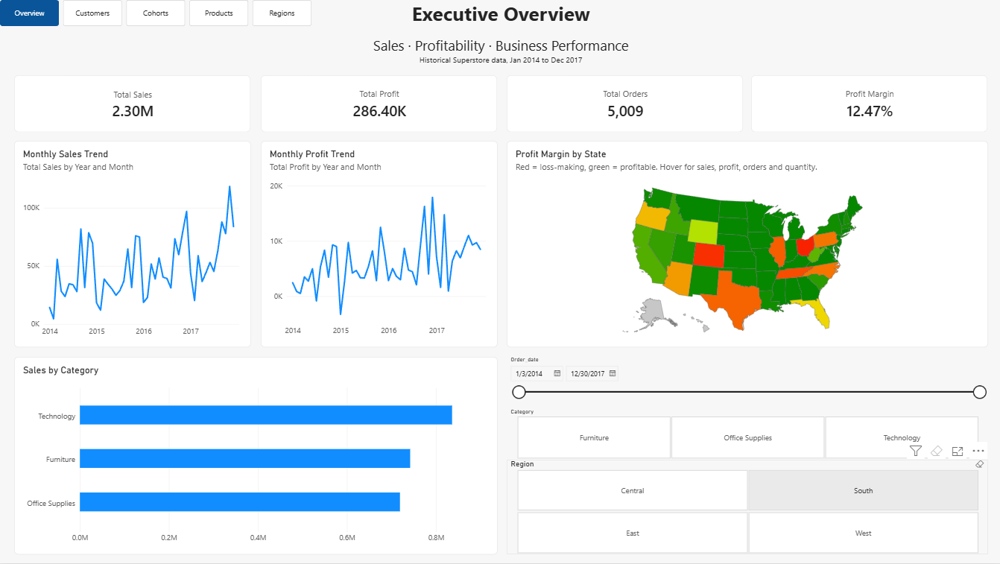
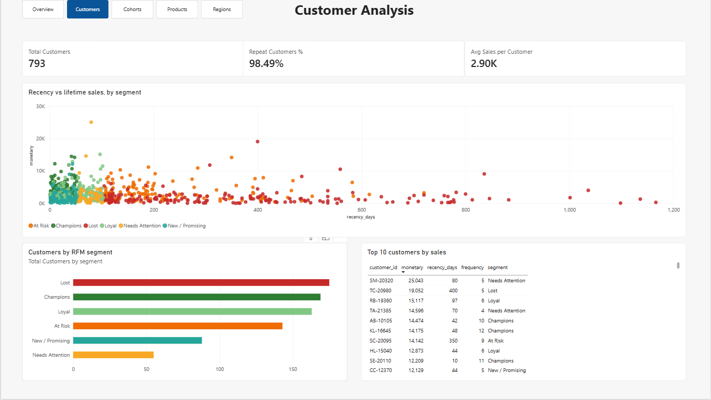
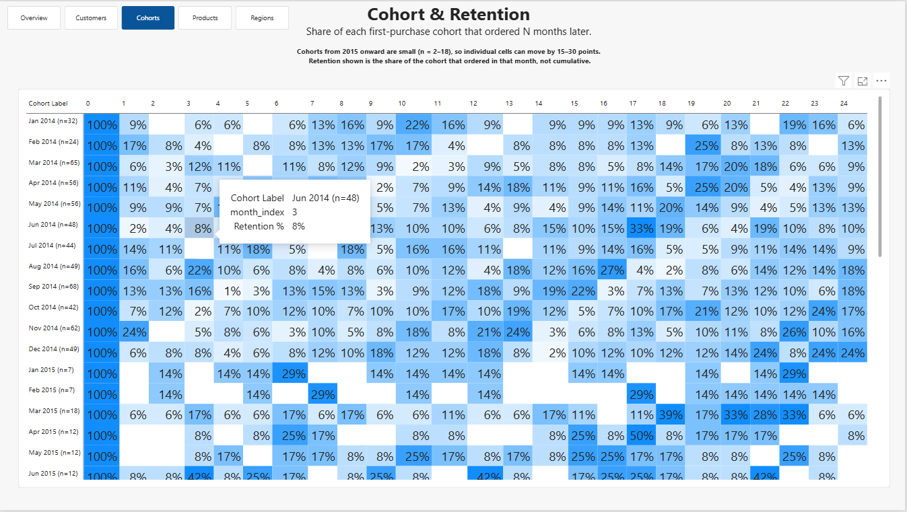
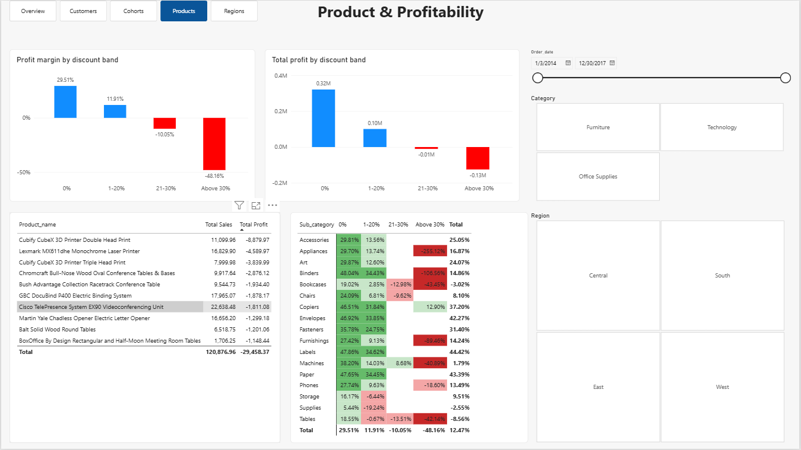

# Superstore Sales & Profitability Analytics Dashboard

An end-to-end data analytics portfolio project using **PostgreSQL, SQL, and Power BI** to analyze sales performance, profitability, customer behavior, retention, and the impact of discounts.

## 📌 Project Overview

This project analyzes historical Superstore sales data from January 2014 to December 2017. The goal is to transform transactional data into actionable business insights through SQL analysis and a five-page interactive Power BI report.

The analysis covers overall business performance, customer segmentation (RFM), cohort retention, product profitability, discount-related losses, and regional performance.

## 🎯 Business Objectives

- Analyze total sales, profit, order volume, and profit margin.
- Compare performance across product categories and sub-categories.
- Identify products and sub-categories associated with significant losses.
- Investigate the relationship between discount levels and profitability.
- Segment customers by recency, frequency, and monetary value (RFM).
- Measure how many customers return after their first purchase (cohort retention).
- Evaluate profitability across states and regions.

## 🛠️ Tools & Technologies

- **PostgreSQL**: data storage, aggregation, CTEs, window functions, and analytical views.
- **SQL**: data quality checks, business metrics, discount analysis, product-level investigation, RFM scoring, and cohort retention.
- **Power BI Desktop**: report design, visuals, slicers, navigation, and conditional formatting.
- **DAX**: KPI measures, discount bands, retention percentage, and cohort labels.

## 📊 Dataset

The project uses the Superstore dataset containing **9,994 rows and 21 columns**.

Key fields include:

- Order Date and Ship Date
- Order ID and Customer ID
- Product ID, Product Name, Category, and Sub-Category
- Region, State, and City
- Sales, Quantity, Discount, and Profit

**Data quality summary**

- No missing values, exact duplicate rows, invalid dates, or out-of-range discounts were found.
- 1,871 rows (about 18.72%) have negative profit. They were kept, because nothing indicated a data error.
- Orders contain multiple product lines, so order counts use `COUNT(DISTINCT order_id)`.
- Some product IDs map to several product names and some names to several IDs, so product-level results are interpreted cautiously (see `sql/16_data_quality_extras.sql`).

## 📈 Key Performance Indicators

| Metric                   |        Result |
| ------------------------ | ------------: |
| Total Sales              | $2,297,200.87 |
| Total Profit             |   $286,397.02 |
| Total Orders             |         5,009 |
| Unique Customers         |           793 |
| Overall Profit Margin    |        12.47% |
| Average Sales / Customer |        ~$2.9K |
| Repeat Customers         |        98.49% |

## 📷 Power BI Report

The report has five pages with a page navigator on each one.

### 1. Executive Overview

High-level business performance.

- KPI cards for sales, profit, orders, and profit margin
- Monthly sales trend and monthly profit trend
- Sales by category
- Profit margin by state (map)
- Date, category, and region slicers



### 2. Customer Analysis

All-time customer view (not affected by the slicers).

- Total customers, repeat-customer share, and average sales per customer
- Customers by RFM segment
- Recency vs. lifetime sales scatter, colored by segment
- Top 10 customers by sales



### 3. Cohort & Retention

Customers are grouped by the month of their first purchase. Each cell shows the share of that cohort that ordered N months later. Row labels include the cohort size (n).



### 4. Product & Profitability

- Profit margin and total profit by discount band
- Sub-category x discount band margin matrix
- The 10 products with the lowest total profit



### 5. Regional Analysis

- Top 10 products by sales
- Sales by region
- Profit by sub-category
- Lowest-profit states


## 🔍 Key Business Findings

All findings describe associations in this dataset. They do not prove cause and effect.

### 1. Technology leads; Furniture has a margin problem

Technology generated **$836.15K in sales and $145.45K in profit (17.40% margin)**. Office Supplies earned **$122.49K at a 17.04% margin**. Furniture produced **$742.00K in sales but only $18.45K in profit (2.49% margin)**.

### 2. Sales and profit do not move together

November 2017 was the highest-sales month ($118,447.83) and February 2014 the lowest ($4,519.89). March 2014 had $55,691.01 in sales but only $498.73 in profit, and July 2014 recorded a loss of $841.48.

### 3. Tables, Bookcases, and Supplies lose money

Tables lost **$17,725.48** on $206,965.54 in sales (about −8.56% margin). Bookcases lost $3,472.56 and Supplies lost $1,189.10. Copiers ($55,617.82), Phones ($44,515.73), and Accessories ($41,936.64) were the most profitable sub-categories.

### 4. Heavy discounts are strongly associated with losses

| Discount band | Profit margin |
| ------------- | ------------: |
| 0%            |        29.51% |
| 1–20%         |        11.91% |
| 21–30%        |       −10.05% |
| Above 30%     |       −48.16% |

- The no-discount group earned **$320,987.60** in profit; the above-30% group lost **$125,006.78**.
- **97.77%** of rows in the above-30% group had negative profit, compared with 0% of no-discount rows.
- Machines had an average discount of 30.61% and a margin of only about 2%.

### 5. The pattern holds within sub-categories

| Sub-category | 30% or less (incl. 0%) | Above 30% |
| ------------ | ---------------------: | --------: |
| Binders      |                 41.09% |  −106.56% |
| Machines     |                 28.64% |   −40.89% |

- Above-30% losses: Binders **$38,510.50**, Machines **$29,881.39**, Tables **$27,295.90**.
- Appliances had the worst high-discount margin (−255.12%), though on small sales.
- The pattern is not universal: Copiers stayed profitable above 30% ($2,182.98 profit, 12.90% margin).
- Storage, Supplies, and Tables were already loss-making in the 1–20% band.
- Across product × discount-band groups with at least three rows, all 152 groups in the above-30% band had negative aggregate profit.

### 6. A few products drive the biggest losses

| Product                              | Net profit | Detail                                                                   |
| ------------------------------------ | ---------: | ------------------------------------------------------------------------ |
| Cubify CubeX 3D Printer, Double Head | −$8,879.97 | Two 70%-discount sales lost $9,239.97; a 20% sale earned $360            |
| Lexmark MX611dhe Laser Printer       | −$4,589.97 | 10% discount earned $680; 40% and 70% discounts lost $5,269.97           |
| Cubify CubeX 3D Printer, Triple Head | −$3,839.99 | One high-discount sale                                                   |
| GBC DocuBind P400                    | −$1,878.17 | ≤30% discounts: $4,981.22 profit (38.13%); above 30%: −$6,859.39 (−140%) |

These comparisons rest on only a handful of transactions each.

### 7. Customers: nearly everyone returns, and some valuable customers have lapsed

- 793 customers; **98.49%** placed more than one order.
- Lost, Champions, and Loyal are the three largest RFM segments.
- Some of the highest-spending customers are labelled "Lost" or "Needs Attention" because their last order was long ago, so recent activity and lifetime value tell different stories.

### 8. Retention is modest and noisy

In most monthly cohorts, roughly 5–25% of customers order again in any single later month. Cohorts from 2015 onward are small (often 2–18 customers), so single cells can move by 15–30 points.

### 9. Regional and state performance is uneven

- West generated the most sales ($725.46K, 31.58%), followed by East ($678.78K), Central ($501.24K), and South ($391.72K).
- Texas (−$25,729.36), Ohio (−$16,971.38), Pennsylvania (−$15,559.96), and Illinois (−$12,607.89) had the largest state-level losses.

## 🧠 SQL Skills Demonstrated

- Filtering, sorting, and aggregating transactional data
- `GROUP BY`, `HAVING`, `CASE`, and `FILTER` clauses
- Distinct counts and profit-margin calculations with `NULLIF`
- Common Table Expressions (CTEs) and window functions (`NTILE`, windowed `SUM`)
- Joins between derived tables (cohort view)
- Reusable analytical views (`vw_cohort_retention`, `vw_rfm`)
- Data quality validation, including ID/name integrity checks
- Reproducibility checks: the same figure confirmed in SQL, Power BI, and the written analysis

## 📐 Power BI Measures

```dax
Total Sales = SUM(superstore[Sales])

Total Profit = SUM(superstore[Profit])

Total Orders = DISTINCTCOUNT(superstore[Order_id])

Profit Margin = DIVIDE([Total Profit], [Total Sales], 0)

Total Customers = DISTINCTCOUNT(vw_rfm[customer_id])

Repeat Customers % =
DIVIDE(
    CALCULATE(DISTINCTCOUNT(vw_rfm[customer_id]), vw_rfm[frequency] > 1),
    [Total Customers]
)

Retention % =
DIVIDE(
    SUM(vw_cohort_retention[customers]),
    CALCULATE(
        SUM(vw_cohort_retention[customers]),
        vw_cohort_retention[month_index] = 0,
        ALLEXCEPT(vw_cohort_retention, vw_cohort_retention[cohort_month])
    )
)
```

`Discount Band` is a calculated column that groups discounts into 0%, 1–20%, 21–30%, and above 30%, matching the SQL buckets.

## 📁 Repository Structure

```
superstore-analytics/
├── sql/                 # numbered SQL scripts (see sql/00_README_SQL_FILES.md)
├── screenshots/         # dashboard page images used in this README
├── superstore.pbix      # Power BI report
└── README.md
```

## 🚀 How to Reproduce the Project

1. Install PostgreSQL and Power BI Desktop.
2. Download the Superstore dataset from a legitimate source.
3. Import it into PostgreSQL as a table named `superstore`.
4. Run the scripts in `sql/` in numeric order. Scripts `19` and `20` create the `vw_cohort_retention` and `vw_rfm` views.
5. Connect Power BI Desktop to PostgreSQL and load `superstore`, `vw_cohort_retention`, and `vw_rfm`.
6. Create the DAX measures and the `Discount Band` and `Cohort Label` columns, then build the pages.
7. Compare the Power BI totals with the SQL results (sales, profit, margin, orders).

## ⚠️ Limitations

- **Association, not causation.** High discounts coincide with losses, but product mix, costs, and pricing may also play a role.
- **Small samples.** Several product-level comparisons use only 3–6 transactions.
- **Small cohorts.** Later cohorts have few customers, so retention percentages are noisy.
- **RFM segments are rule-based.** Segment definitions use simple score thresholds and are only one way to group customers.
- **Customer and cohort pages are all-time views.** The date, category, and region slicers do not filter them.
- **Product identifiers are inconsistent.** Some product IDs and names do not map one-to-one.
- **Historical data.** Results describe 2014–2017 and are not current business performance.

## 📚 What I Learned

This project practiced translating business questions into SQL, validating KPIs across tools, and presenting findings in an interactive report. It also showed that sales and profit tell different stories, that discount findings need cautious wording, and that small groups can make percentages look more dramatic than they are.

## 👤 Author

**Sefat Khan**

Aspiring Data Analyst / Data Science Intern

- GitHub: [GitHub](https://github.com/sefatkhan2231-stack/sql-analytics-dashboard.git)

---

_This project was developed for learning and portfolio demonstration using historical Superstore data. Findings describe the dataset and should not be interpreted as current business performance._
